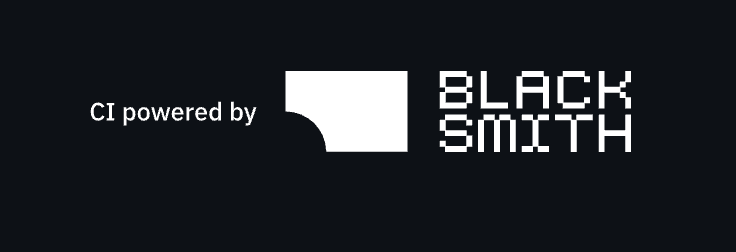
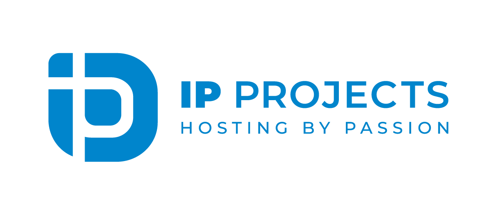

  <strong>
    A to-do list, time tracker and daily planner for focused personal work. Private, offline-first and open source.
  </strong>

  :globe_with_meridians: <a href="https://app.super-productivity.com">Open Web App</a> or :computer: <a href="https://super-productivity.com/download/">Download</a>

 

<!-- The <a> and  elements are intentionally made without space.
     Because of the extra whitespace characters in <a>, makes blue underline lines appear for them.
     Please do not change this formatting, so as not to make them.
-->

  
  &nbsp;
  
  &nbsp;
  

  Free and open source since 2017 · No account · No tracking · Works offline

  
  &nbsp;
  
  &nbsp;
  

  

## :bulb: How it works

1. **Capture it.** Type `Call Anna @tomorrow 3pm` and the date is set. Pull in issues assigned to you from Jira, GitHub, GitLab and more.
2. **Plan your day.** Pick today's tasks and see them on the schedule, next to your calendar events.
3. **Focus.** Pick a task and start a Pomodoro, Flowtime or countdown session. Time is tracked on it, and a break reminder tells you when to step away.
4. **Finish the day.** Review what you got done, then log it: export a timesheet or send worklogs to Jira, GitLab, OpenProject or Redmine.

Built for one person's focused work, not team management. Your data stays on your device unless you choose to sync it.

## :computer: Downloads & Install

  
  
  
  
  
  
  

  <strong>For all current downloads, package links, and platform-specific notes:
    <a href="https://super-productivity.com/docs/how-to/downloads-and-install/" target="_blank">
      see the docs
    </a>
  </strong> 
  

  <a href="https://bank.gov.ua/en/news/all/natsionalniy-bank-vidkriv-rahunok-dlya-gumanitarnoyi-dopomogi-ukrayintsyam-postrajdalim-vid-rosiyskoyi-agresiyi" target="_blank">
     
    <strong>Humanitarian Aid for Ukraine</strong> 
    Support humanitarian relief via the official National Bank of Ukraine account.
  </a>

## :heavy_check_mark: Features

- **Keep organized and focused!** Plan and categorize your tasks using sub-tasks, projects and tags and color code them as needed.
- **Plan ahead** with the **planner** and see your day laid out on the **schedule** timeline, next to your calendar events.
- Sort tasks visually on **boards**, like the built-in **Kanban** and **Eisenhower Matrix**, or build your own.
- Use **timeboxing** and **track your time**. Create time sheets and work summaries in a breeze to easily export them to your company's time tracking system.
- Helps you to **establish healthy & productive habits**:
  - A **break reminder** reminds you when it's time to step away.
  - The **anti-procrastination feature** helps you gain perspective when you really need to.
  - Need some extra focus? **Focus mode** offers **Pomodoro**, **Flowtime** and **countdown** sessions.
  - **Collect personal metrics** to see, which of your work routines need adjustments.
- Integrate with **Jira**, **Trello**, **GitHub**, **GitLab**, **Gitea**, **OpenProject**, **Linear**, **ClickUp**, **Redmine**, **Nextcloud Deck** and **Azure DevOps**. Auto import tasks assigned to you, plan the details locally, automatically create work logs, and get notified immediately, when something changes.
- Basic **CalDAV** integration.
- Back up and synchronize your data across multiple devices with **SuperSync**, **Dropbox** and **WebDAV** support. SuperSync is our own sync service, end-to-end encrypted with a password only you hold, which you can also [host yourself](https://github.com/super-productivity/super-productivity/tree/master/packages/super-sync-server).
- Attach context information to tasks and projects. Create **notes**, attach **files** or create **project-level bookmarks** for links, files, and even commands.
- Super Productivity **respects your privacy** and **does NOT collect any data**. No account or registration is required. **You decide where you store your data!**
- Extend and restyle the app with **[plugins](https://super-productivity.com/docs/contributing/develop-a-plugin/)** and **[custom themes](https://super-productivity.com/docs/reference/theming/)**.
- Runs on **Linux**, **macOS**, **Windows**, **Android**, **iOS** and in the **browser**.
- It's **free** and **open source** and always will be.

And much more!

## :scales: How it compares

|                                                 | Super Productivity | Todoist | TickTick | Sunsama |
| ----------------------------------------------- | ------------------ | ------- | -------- | ------- |
| Open source                                     | ✅                 | ❌      | ❌       | ❌      |
| No account needed                               | ✅                 | ❌      | ❌       | ❌      |
| Offline-first, data stays on your device        | ✅                 | ❌      | ❌       | ❌      |
| Time tracking on tasks, with timesheet export   | ✅                 | ❌      | ⚠️       | ⚠️      |
| Focus timer and break reminders                 | ✅                 | ❌      | ✅       | ✅      |
| Day planned on a schedule next to your calendar | ✅                 | ⚠️      | ✅       | ✅      |
| Jira, GitHub and GitLab integration             | ✅                 | ❌      | ❌       | ⚠️      |
| Every feature free                              | ✅                 | ❌      | ❌       | ❌      |

`✅` yes · `⚠️` partial, limited or paid plan only · `❌` no. Based on each product's public information, checked November 2026. Spot something outdated? [Open an issue](https://github.com/super-productivity/super-productivity/issues) with a source.

> [!NOTE]
> The web version has some limitations: See the **[Web App vs Desktop comparison](https://super-productivity.com/docs/reference/web-app-vs-desktop/)** for more details.

## :book: Documentation and Guides

<!-- Getting Started -->
<h3>Getting Started</h3>
<ul>
  <li><a href="https://dev.to/johannesjo/getting-started-with-super-productivity-2791">Getting started guide</a> (article)</li>
  <li><a href="https://www.youtube.com/watch?v=VoF2_RSdNXA">Video walkthrough</a> (YouTube)</li>
  <li><a href="https://dev.to/johannesjo/the-prioritising-scheme-how-to-eat-the-frog-with-super-productivity-mlk">Eat the frog prioritizing scheme</a></li>
</ul>

<strong>Starting Point in the Docs:</strong> 
  <a href="https://super-productivity.com/docs/tutorials/first-steps/">First steps</a> •
  <a href="docs/public/explanation/your-first-week.md">Your first week</a> •
  <a href="https://super-productivity.com/docs/reference/">Reference</a> •
  <a href="https://super-productivity.com/docs/how-to/">How-To</a>

<strong>Productivity Tips:</strong> 
  <a href="https://super-productivity.com/docs/reference/keyboard-shortcuts/">Keyboard Shortcuts</a> •
  <a href="https://super-productivity.com/docs/reference/short-syntax/">Short Syntax</a>

<strong>Need Help?</strong> 
  <a href="https://github.com/super-productivity/super-productivity/discussions">Visit the discussions page</a>

See the bottom of the README for more information on the documentation.

<!-- Advanced Topics -->
<h3>Advanced Topics</h3>

Here are some other topics covered in the
  <a href="https://super-productivity.com/docs/">documentation</a>:

<strong>Development:</strong> 
  <a href="https://super-productivity.com/docs/contributing/run-the-development-server/">Run dev server</a> •
  <a href="https://super-productivity.com/docs/contributing/package-the-app/">Package the app</a> •
  <a href="https://super-productivity.com/docs/contributing/build-for-android/">Build for Android</a> •
  <a href="https://super-productivity.com/docs/how-to/run-with-docker/">Run with Docker</a>

<strong>Data Management:</strong> 
  <a href="https://super-productivity.com/docs/explanation/managing-your-data/">User Data</a> •
  <a href="https://super-productivity.com/docs/reference/issue-integration-comparison/">Issue Providers</a> •
  <a href="https://super-productivity.com/docs/reference/sync-integration-comparison/">Sync Providers</a>

<strong>Customization:</strong> 
  <a href="https://super-productivity.com/docs/contributing/develop-a-plugin/">Plugins</a> •
  <a href="https://super-productivity.com/docs/reference/theming/">Themes</a>

<strong>APIs:</strong> 
  <a href="https://super-productivity.com/docs/reference/api/#1-sync-server-rest-api">Sync Server</a> •
  <a href="https://super-productivity.com/docs/reference/api/#2-plugin-api">Plugins</a> •
  <a href="https://super-productivity.com/docs/reference/api/#3-local-rest-api">REST</a>

## Community

The development of Super Productivity is driven by a wonderful community of users and contributors. Thank you all so much for your support!

  :eyes:
  <a href='https://github.com/super-productivity/awesome-super-productivity'>
    Check out our awesome curated list of community-created resources about Super Productivity
  </a>

### :hearts: Contributing

You don't have to be a programmer to help: spread the word, [answer questions](https://github.com/super-productivity/super-productivity/discussions), [report bugs](https://github.com/super-productivity/super-productivity/issues/new), [contribute translations](https://super-productivity.com/docs/contributing/contribute-translations/), build [plugins](https://super-productivity.com/docs/contributing/develop-a-plugin/) or [themes](https://super-productivity.com/docs/reference/theming/), or [sponsor the project](https://github.com/sponsors/johannesjo).

Before opening a pull request, read [CONTRIBUTING.md](CONTRIBUTING.md) and follow the [commit message format](.github/CONTRIBUTING.md#commit-message-format).

[//]: # ''
[//]: #
[//]: # 'You can use the Fink Localization Editor to edit, lint, and add translations for different languages. [Contribute via fink Guide](https://inlang.com/g/6ddyhpoi).'

### Special Thanks to our Sponsors

A big thank you to all our sponsors!

- **[SignPath.io](https://signpath.io?utm_source=foundation&utm_medium=github&utm_campaign=super-productivity)**: free code signing for our Windows binaries, with a certificate by [SignPath Foundation](https://signpath.org?utm_source=foundation&utm_medium=github&utm_campaign=super-productivity).
- **[Blacksmith](https://www.blacksmith.sh)**: covers all our CI runner minutes for GitHub Actions.

  

- **[IP-Projects](https://ip-projects.de?sp)**: hosts our servers.

  

_(If you are, intend to or have been a sponsor and want to be shown here, [please let me know](mailto:contact@super-productivity.com)!)_

## Documentation: Manual versus Automated

There are two sets of docs: the official one, maintained in this repository, and the autonomously generated variant using [DeepWiki.com](https://deepwiki.com/super-productivity/super-productivity). The manually curated version is a more stable and approachable resource designed to help you understand the app from a more human-focused perspective whereas DeepWiki is optimized for explaining the code itself with little regard for context beyond that.

<!-- Official Wiki -->
<h3>Official Wiki</h3>

  It is preferable to maintain local documentation rather than rely on an external service.
  It is also preferable that the documentation is updated in tandem with the code changes as
  demonstrated in
  <a href="https://github.com/super-productivity/super-productivity/commit/7a51d4b06e414fdcc48e4999197a93eee9cd09da">this commit</a>.

  Changes to files within <code>./docs/wiki</code> are linted in CI and published, together with the
  rewritten pages in <code>./docs/public</code>, at
  <a href="https://super-productivity.com/docs/">super-productivity.com/docs</a>. The GitHub Wiki
  only keeps one stub per page that links to its new address.

  The wiki is being rewritten page by page into <code>./docs/public</code>, following the
  <a href="docs/documentation-guide.md">documentation guide</a>. There are some automations in development to help reduce the difference between the published docs and the state of the code while retaining a human-in-the-loop.

<!-- DeepWiki -->
<h3>DeepWiki.com</h3>

  If you have very specific questions about how the code works or why a bug might be producing
  a particular message it might be useful to
  . It can help "cite your sources" when discussing functionality and code that you don't fully
  understand as part of feature requests or bug reports.

  This automated
  <a href="https://diataxis.fr/reference/#reference">reference</a>
  does come with some significant drawbacks:

<ol>
  <li><strong>Intent:</strong> Describes what code does, not why decisions or tradeoffs were made.</li>
  <li><strong>Staleness:</strong> Will *always* lag behind the code.</li>
  <li><strong>Code-Focused:</strong> Does not provide guides or conceptual explanations.</li>
  <li><strong>Cost:</strong> Potential future cost and higher resource usage than static docs.</li>
</ol>
